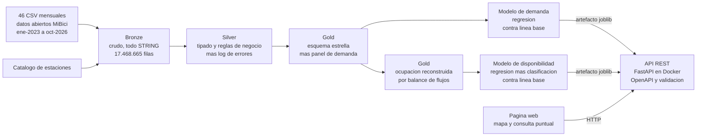
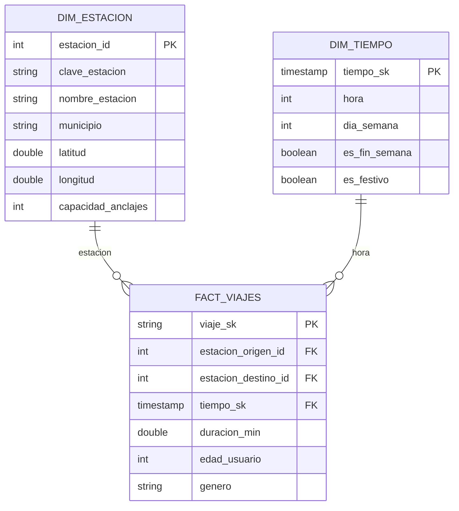

# MiBici · Predicción de demanda y disponibilidad de estaciones

[](https://github.com/PIRATA131/Mibici/actions/workflows/mantener-vivo.yml)

Dos modelos sobre 17.4 millones de viajes, servidos por un API público:

- **Para el operador** — cuántas bicicletas van a salir y llegar a cada estación en una hora dada,
  y cuántas habría que trasladar para que no se quede sin servicio.
- **Para el usuario** — *«voy a esta estación el viernes a las 6, ¿va a haber bicicleta?»*

**Proyecto final** — Aprendizaje Automático para Grandes Volúmenes de Datos
Especialidad en Ciencia de Datos · Universidad Panamericana, campus Guadalajara

Profesor: Dr. Ramón Alejandro Briseño Martínez

Equipo: **César Roberto Murillo Figueroa** y **Andrés Muñoz Rubalcava**

---

## En vivo

| | |
|---|---|
| **Aplicación web** | https://mibici-api-v8k6.onrender.com/app/ |
| **Documentación del API** (OpenAPI) | https://mibici-api-v8k6.onrender.com/docs |
| **Estado del servicio** | https://mibici-api-v8k6.onrender.com/salud |

> **Cómo comprobar que está vivo.** La aplicación lleva un panel arriba a la derecha que muestra
> cada llamada al API y, al desplegarlo, la petición y la respuesta tal cual viajaron; además
> `/salud` devuelve `servidor_hora` en UTC, para confirmar que la respuesta es de ese momento y no
> de una caché. La insignia del encabezado no mira solo el código HTTP: comprueba que el modelo
> esté cargado y pide una predicción real. Render duerme el servicio tras 15 minutos sin uso, así
> que la primera visita puede tardar medio minuto.

---

## El problema

MiBici es el sistema de bicicleta pública del área metropolitana de Guadalajara: 470 estaciones,
unos 7,995 anclajes y cerca de 400 mil viajes al mes. Tiene un problema que cualquiera que lo use
ha sufrido: **hay estaciones que se vacían y estaciones que se saturan**, todos los días, a las
mismas horas.

Los datos lo dicen sin ambigüedad. La estación **GDL-127, Av. Vallarta / Av. de Los Arcos**, tiene
19 anclajes. Un viernes a las 6 de la tarde salen de ahí 35.6 bicicletas y llegan 3.2:

```
salidas 35.6  −  llegadas 3.2  =  déficit de 32.4 bicicletas
32.4 bicicletas ÷ 19 anclajes  =  la estación se vacía 1.7 veces en una hora
```

Hoy el operador mueve bicicletas en camioneta por intuición y por reportes de usuarios, es decir,
reaccionando cuando el problema ya ocurrió. Este proyecto responde la pregunta un paso antes:
**¿cuántas bicicletas va a necesitar cada estación, mañana, a cada hora?**

---

## Qué se construyó



| Capa | Qué hace | Dónde está |
|---|---|---|
| **Bronze** | Ingesta cruda. Nada se castea, nada se limpia, nada se descarta | [`Notebooks/01_bronze_ingesta.py`](Notebooks/01_bronze_ingesta.py) |
| **Silver** | Tipado, fechas ISO, 10 validaciones, log de errores | [`Notebooks/02_silver_limpieza.py`](Notebooks/02_silver_limpieza.py) |
| **Gold** | Esquema estrella y panel de demanda | [`Notebooks/03_gold_estrella.py`](Notebooks/03_gold_estrella.py) |
| **Modelo 1** | Demanda: cuántas salen y llegan | [`Notebooks/04_modelo_demanda.py`](Notebooks/04_modelo_demanda.py) |
| **Gold** | Reconstrucción de la ocupación por estación y hora | [`Notebooks/05_gold_ocupacion.py`](Notebooks/05_gold_ocupacion.py) |
| **Modelo 2** | Disponibilidad: ¿habrá bicicletas, y cuántas? | [`Notebooks/06_modelo_disponibilidad.py`](Notebooks/06_modelo_disponibilidad.py) |
| **API** | Expone los dos modelos como servicio consultable | [`api/`](api/) |
| **Web** | Consume el API: mapa y consulta puntual | [`web/index.html`](web/index.html) |

---

## Los datos

**Fuente:** [datos abiertos de MiBici](https://www.mibici.net/es/datos-abiertos/), publicados por el
Instituto de Movilidad y Transporte de Jalisco. Un CSV por mes más el catálogo de estaciones.

| | |
|---|---|
| Periodo | enero 2023 – octubre 2026 (46 meses) |
| Viajes | **17,468,665** |
| Válidos tras las reglas | 16,750,528 (95.89 %) |
| Incidencias registradas | 723,673 |
| Estaciones | 475 (470 del catálogo + 5 sin ficha) |
| Tamaño crudo | 1.39 GB (302 MB comprimido) |

### Lo que el perfilado encontró antes de escribir una línea de pipeline

Los 46 archivos **no son homogéneos**, y eso es lo que justifica que exista una capa Silver:

| Variación | Detalle |
|---|---|
| Codificación | 27 archivos en `windows-1252`, 19 en `UTF-8 con BOM` |
| Comillas y saltos de línea | 43 entrecomillados con `LF`; 3 sin comillas y con `CRLF` |
| Formato de fecha | 43 archivos en `aaaa-mm-dd hh:mm:ss`; **3 en `dd/mm/aaaa h:mm`** |
| Encabezado | `Año_de_nacimiento` aparece con 3 secuencias de bytes distintas, 2 corruptas |
| Duplicados | **758 filas idénticas** repetidas dentro del mismo mes: mismo viaje, usuario y horas |

Un hallazgo que simplificó la ingesta: se verificó byte por byte que **ninguna fila de datos
contiene caracteres fuera de ASCII**. La `ñ` vive solo en el encabezado, que se descarta al leer.
Por eso Spark puede leer los 46 archivos en una sola pasada como UTF-8, sin partir la ingesta en
dos grupos por codificación.

---

## Las reglas de negocio

Siguen el estilo del taller RUES visto en clase. La regla que manda sobre todas las demás:
**un registro inválido no se borra.** Se conserva con `registro_valido = false` y cada violación
se escribe en el log de errores con `columna`, `mensaje_error` y `valor`. Borrarlos haría
imposible auditar después por qué desapareció un viaje, o medir si una regla es demasiado
agresiva.

| Regla | Qué hace |
|---|---|
| RN-01 | Unifica el esquema entre las tres variantes de formato |
| RN-02 | Nombres en `snake_case` sin acentos |
| RN-03 | Fechas a ISO 8601 desde los dos formatos de origen |
| RN-04 | Variables derivadas: duración, edad, calendario |
| RN-05 | Llave única `viaje_sk = anio-mes-viaje_id` |
| RN-06 | Columnas de auditoría: archivo de origen y fecha de carga |
| RN-07 | Los inválidos se marcan y se registran, no se eliminan |
| RN-08 | Detecta duplicados exactos comparando la tupla completa del viaje |

### Las diez validaciones y lo que encontraron

| Columna | Incidencia | Registros | Por qué importa |
|---|---|---:|---|
| `duracion_min` | Duración menor a 60 s | 549,047 | Falso retiro: sacan la bici y la regresan de inmediato |
| `genero` | Nulo o fuera de `{M,F,O}` | 115,563 | El usuario no declaró género |
| `duracion_min` | Fin ≤ inicio | 44,800 | Viaje imposible; error de reloj en la estación |
| `anio_nacimiento` | Nulo | 11,005 | Dato faltante en el registro |
| `edad_usuario` | Fuera de [10, 100] | 2,456 | Hay años de nacimiento como `199` o `2023` |
| `duracion_min` | Mayor a 24 h | 44 | Bicicleta no devuelta, no un viaje |
| `viaje_sk` | Registro duplicado exacto | 758 | La misma fila capturada dos veces en el origen |
| `inicio_viaje` / `fin_viaje` | No parseable | 0 | Las dos variantes de formato quedaron cubiertas |
| `origen_id` / `destino_id` | Estación nula | 0 | Sin estación no hay join con la dimensión |

**Cómo se evita que la bandera y el log se contradigan:** las dos salen del mismo arreglo.
`registro_valido` es `size(incidencias) == 0` y el log es el `explode` de ese mismo arreglo.

**Sobre los 758 duplicados.** No los encontró el perfilado: los encontró el pipeline. La llave
`viaje_sk` no resultó única y la diferencia era exactamente 758. Al revisarlas resultaron ser filas
idénticas —mismo viaje, mismo usuario, mismas horas— repetidas dentro del mismo mes. De esas copias,
**741 eran por lo demás válidas** y las descarta RN-08; las otras 17 ya estaban marcadas por alguna
de las seis reglas anteriores. La copia no se borra: se marca inválida y se registra, igual que
cualquier otra incidencia. Así `viaje_sk` sí es única **entre los registros válidos**, que son los
únicos que llegan al esquema estrella.

### Las cinco estaciones fantasma

Cinco identificadores aparecen en los viajes pero no en el catálogo vigente de octubre 2026.
Las 240 y 310 se dieron de baja; las 124, 405 y 407 son altas que el catálogo aún no publica.
Entre las cinco tocan **14,047 viajes**. Se agregan a `dim_estacion` como *unknown members* en
lugar de descartar esos viajes, para que **ningún hecho quede huérfano de dimensión**.

---

## El esquema estrella



`FACT_VIAJES` apunta dos veces a `DIM_ESTACION`, por el origen y por el destino del viaje.

Más una tabla agregada, `gold_agg_demanda_estacion_hora`, que es la que entrena el modelo: una
fila por estación y hora de servicio, con salidas, llegadas, déficit y variables de rezago.

**La decisión de diseño que hay que defender ahí:** el panel incluye los ceros, porque un modelo
que solo ve horas con viajes sobreestima la demanda en todas partes. Pero no se densifica a lo
bruto: la red creció de 300 a 470 estaciones entre 2023 y 2026, y una estación inaugurada en 2026
no tuvo "cero demanda" en 2023 — simplemente no existía. Cada estación se densifica **solo dentro
de su propia vida útil**.

---

## El modelo 1 — demanda

> Responde al **operador**: dónde mandar la camioneta.

**Tarea: regresión.** Dos modelos, uno para salidas y otro para llegadas, porque el déficit es la
diferencia entre ambos y una estación puede tener mucho movimiento y estar en equilibrio.

**Métrica: RMSE, en bicicletas.** Se eligió sobre R² porque está en la unidad de la decisión —un
RMSE de 2.4 significa "se equivoca por unas 2.4 bicicletas", que se puede comparar contra la
capacidad de la estación y contra el costo de mandar un camión— y porque castiga más los errores
grandes, que aquí es lo correcto: fallar por 20 bicis en hora pico deja gente a pie, fallar por 1
en una estación tranquila no le importa a nadie. Se reporta **MAE** junto a él como control.

**Contra qué se compara: el promedio histórico** de esa estación, ese día de la semana y esa hora.
Es lo que cualquiera haría sin modelo. Un gradient boosting que no le gane no justifica su
existencia, y medirlo es parte del trabajo.

**Partición temporal, no aleatoria.** Se entrena con datos hasta el 31 de agosto de 2026 y se
evalúa con septiembre y octubre. Una partición aleatoria dejaría filtrarse el lunes siguiente al
entrenamiento y daría una métrica inflada que no se sostiene en producción.

### Los resultados, y por qué el margen era estrecho

Partición temporal: entrena con 4,791,477 filas hasta el 31 de agosto de 2026, evalúa con las
542,431 de septiembre y octubre.

| Objetivo | Línea base | Modelo | Mejora |
|---|---|---|---|
| salidas | RMSE 1.911 | **1.883** | +1.5 % |
| llegadas | RMSE 1.919 | **1.894** | +1.3 % |

**Un 1.5 % parece poco, y lo es — pero la comparación contra cero es la equivocada.** La demanda de
bicicletas es un conteo: aunque conocieras con precisión perfecta la tasa λ de una estación a una
hora, el número exacto variaría por azar. En un proceso de Poisson la varianza iguala a la media, así
que el error mínimo alcanzable es `√λ`. Con la demanda observada, ese piso es **1.401 bicicletas**.

| Objetivo | Piso teórico | Línea base | Modelo | Margen disponible | Capturado |
|---|---|---|---|---|---|
| salidas | 1.401 | 1.911 | 1.883 | 0.510 | **5.5 %** |
| llegadas | 1.401 | 1.919 | 1.894 | 0.518 | **4.7 %** |

La lectura honesta: **el promedio histórico ya está a medio bici del límite de lo predecible**, y el
gradient boosting cierra un 5 % de esa distancia. El resto es ruido irreducible, no falta de modelo.

El desglose por hora lo confirma y contradice la intuición: la mayor mejora está en el pico matutino
(3.0 % a las 8 h) y la menor justo en el pico de la tarde (0.8 % a las 18 h), que es cuando más se
necesitaría. Por eso el API **declara siempre qué está respondiendo**: si un día el modelo deja de
aportar, cambiar a la línea base es una decisión defendible, no una derrota.

### Por qué scikit-learn y no Spark MLlib

Spark hace el trabajo de volumen: convierte 17.4 millones de viajes en un panel agregado. Ese
panel ya cabe en memoria, y el entrenamiento corre con `HistGradientBoostingRegressor`.

La razón es de despliegue. Un modelo de MLlib solo se carga desde Spark, así que servirlo
obligaría a meter una JVM y Spark completo dentro del contenedor del API. El artefacto de
scikit-learn pesa unos megabytes y arranca en milisegundos, que es lo que un servicio HTTP
necesita. **Spark para los datos, scikit-learn para el modelo que se sirve.**

### El desajuste de features que hubo que resolver

El modelo usa variables de rezago —el promedio de las últimas 4 semanas para esa estación, día y
hora—. Al predecir un viernes futuro, ese promedio no existe todavía.

La tentación era usar el promedio histórico de 12 meses que el API ya tenía, pero habría sido un
error silencioso: el modelo se entrenó con una media de 4 observaciones (ruidosa) y recibiría una
de 52 (suave). Misma columna, otro significado. **El artefacto carga su propia tabla de rezagos**,
calculada sobre las últimas 4 semanas, con la misma ventana y la misma semántica del
entrenamiento.

---

## El modelo 2 — disponibilidad

> Responde al **usuario**: *«voy a esta estación el viernes a las 6, ¿va a haber bicicleta?»*

### El obstáculo: los datos no traen el inventario

Para responder esa pregunta hace falta saber cuántas bicicletas hay ancladas en la estación. **Los
datos abiertos de MiBici no lo publican.** Publican viajes: quién salió, de dónde, a qué hora y a
dónde llegó. El inventario nunca se observa.

Así que la ocupación no se puede *medir*. Se **reconstruye**
([`05_gold_ocupacion.py`](Notebooks/05_gold_ocupacion.py)), con un balance de flujos acotado por la
capacidad física de la estación:

```
bicis_fin(h) = recortar( bicis_inicio(h) + llegadas(h) − salidas(h),  0,  capacidad )
bicis_inicio(h+1) = bicis_fin(h)
```

El recorte es lo que convierte una cuenta aritmética en un modelo físico: una estación no puede
tener −4 bicicletas ni 30 bicicletas en 19 anclajes. Cada día arranca de cero porque MiBici
rebalancea de noche, lo que impide que el error se acumule a lo largo de 46 meses.

### Cuánto pesa el supuesto, medido en lugar de asumido

El balance descansa en algo que no observamos: **con cuántas bicicletas amanece cada estación**.
Suponemos la mitad de la capacidad. En lugar de dejarlo ahí, el notebook calcula **las tres
trayectorias en la misma pasada** —arrancando a 25 %, 50 % y 75 %— y compara la etiqueta «se quedó
sin bicis»:

| Comparación | Coinciden |
|---|---|
| arrancar a 50 % vs 25 % | 92.08 % de las horas |
| arrancar a 50 % vs 75 % | 97.79 % de las horas |
| **las tres de acuerdo** | **89.87 %** |

Horas con estación vacía en el panel completo: **4.48 %**.

**La lectura honesta es que en 1 de cada 10 horas la etiqueta depende del supuesto.** No es
despreciable y no se esconde. Lo que sí tranquiliza es la asimetría: subir el supuesto casi no
cambia nada (97.79 %) y bajarlo sí (92.08 %), lo que indica que al 50 % la mayoría de las
estaciones no están cerca del cero, y que el error posible va en una sola dirección — suponer
menos bicicletas fabrica más «vacías». El 50 % es la opción conservadora.

**Una consecuencia que hay que declarar:** cuando una estación se vacía, quien llega y no encuentra
bicicleta *no deja rastro en los datos* — no hay viaje que registrar. Las salidas observadas son
un piso de la demanda real. El modelo puede afirmar **que no habrá bicicletas**, pero no **a cuánta
gente dejó a pie**.

### Dos salidas, porque la pregunta tiene dos mitades

[`06_modelo_disponibilidad.py`](Notebooks/06_modelo_disponibilidad.py) entrena dos modelos sobre
esa reconstrucción:

| | Tarea | Objetivo | Por qué |
|---|---|---|---|
| **A** | Regresión | `bicis_inicio` | «cuántas bicicletas» pide un número |
| **B** | Clasificación | `se_vacio` | «¿habrá o no?» pide una probabilidad |

No basta con una. Un promedio de 2 bicicletas puede venir de «casi siempre hay 2» o de «la mitad
de los días hay 4 y la otra mitad ninguna», y a quien va a caminar hasta allá esa diferencia le
importa toda.

### Aquí sí hay F1, y es deliberado

En el modelo 1 argumentamos que **F1 no aplicaba**: no había clases, había conteos. Aquí la
situación es la contraria. La clase «se vació» es **minoritaria: 3.00 %** de las horas de la
partición de prueba. Un modelo que siempre dijera «sí habrá bicis» acertaría el 97 % de las veces
y sería completamente inútil. Por eso:

- **AUC-PR** como métrica principal, que es la correcta cuando la clase positiva es rara;
- **F1** en el umbral de operación;
- **Brier** para saber si las probabilidades están *calibradas*, no solo ordenadas.

### Los resultados

Misma partición temporal que el modelo 1: entrena con 4,791,477 filas hasta el 31 de agosto de
2026, evalúa con las 542,431 de septiembre y octubre. Los dos modelos son directamente comparables.

**A · ¿Cuántas bicicletas?**

| | Línea base | Modelo | Mejora |
|---|---|---|---|
| RMSE (bicicletas) | 2.7931 | **2.7197** | +2.6 % |
| MAE (bicicletas) | 1.9597 | **1.9319** | +1.4 % |

**B · ¿Habrá bicicletas?**

| | Línea base | Modelo | Mejora |
|---|---|---|---|
| **AUC-PR** | 0.1990 | **0.3260** | **+63.8 %** |
| ROC-AUC | 0.7509 | **0.9166** | +22.1 % |
| F1 | 0.3069 | **0.3644** | +18.7 % |
| Brier *(menor es mejor)* | 0.0275 | **0.0239** | +13.0 % |

El contraste con el modelo 1 es el hallazgo: **la demanda mejoraba 1.5 %; este clasificador mejora
64 %.** No es que esté mejor hecho — es que predecir *un evento raro* deja mucho más margen que
predecir un promedio que la media histórica ya captura bien.

Y para que el 0.326 no se lea como poco: con 3 % de casos positivos, **un clasificador al azar daría
AUC-PR 0.03**. El modelo está casi **11 veces** por encima del azar; la regla histórica, 6.6 veces.

La regresión de «cuántas bicis» mejora poco (+2.6 %), igual que el modelo 1, y por la misma razón:
el promedio de las últimas cuatro semanas ya es un predictor fuerte. **El valor de este modelo está
en el clasificador, no en la regresión**, y conviene decirlo así.

### El umbral es una decisión de producto

El modelo entrega una probabilidad; la aplicación tiene que dar una respuesta. El umbral que las
separa **no es 0.5 por omisión**: se barre el rango y se elige el que maximiza F1 sobre la clase
minoritaria. Quedó en **0.21**.

En ese punto de operación:

| | Precisión | Exhaustividad | F1 |
|---|---|---|---|
| Línea base | 0.212 | **0.555** | 0.307 |
| Modelo | **0.323** | 0.418 | **0.364** |

El modelo **acierta 1.5 veces más** cuando dice «no va a haber bicis», a cambio de detectar menos
casos que la regla histórica. Conviene decirlo así de claro en lugar de enseñar solo el F1.

**Y conviene ser explícito sobre algo que es fácil deslizar.** El costo de los dos errores no es
simétrico: mandar a alguien a una estación vacía es peor que desviarlo de una que sí tenía bicis.
Pero **F1 es un criterio balanceado y no codifica esa asimetría**. Si quisiéramos favorecerla de
verdad, el criterio sería F-beta con beta > 1 y el umbral bajaría.

Lo que sí hacemos con la asimetría es la decisión de diseño que importa: **el API devuelve la
probabilidad cruda, no solo el sí/no**. `hay_bicis` es una comodidad; `probabilidad_sin_bicis` es
el dato. Quien pese distinto los dos errores pone su propio corte sin reentrenar nada, y la página
muestra tres niveles en vez de un binario por la misma razón.

### Las probabilidades significan algo

Que un modelo **ordene** bien no implica que sus probabilidades **signifiquen** algo. Si la
aplicación muestra «49 % de probabilidad de que no haya bici», ese 49 % tiene que cumplirse
aproximadamente 49 de cada 100 veces.

Se comprueba por deciles: **el peor desvío de calibración es 0.024**. Por debajo de 0.05, así que
la página puede mostrar la probabilidad tal cual, y lo hace.

### Lo que la reconstrucción deja ver: una estación con los dos problemas el mismo día

La tabla de estaciones más conflictivas puso arriba a **GDL-049**, con 39 anclajes y
`prob_sin_bicis = 1.000` los martes a las 8 de la mañana. Un número así, en una estación grande,
obliga a comprobar si es real o un artefacto del método. El perfil de un martes cualquiera lo
aclara:

| hora | salidas | llegadas | bicis al inicio |
|---|---|---|---|
| 9 | 18.2 | 7.2 | **0.0** |
| 11 | 11.4 | 9.1 | 0.5 |
| 13 | 11.5 | 10.5 | 1.6 |
| 15 | 13.7 | 30.7 | 7.4 |
| 17 | 18.7 | 46.7 | 36.7 |
| 18 | 27.0 | 59.7 | **39.0** |
| 23 | 3.4 | 2.1 | 37.0 |

Es real, y es un patrón de libro: **una estación residencial de origen**. Por la mañana la gente
sale de ahí y la vacía antes de las nueve; por la tarde regresa y la llena hasta el tope. A las 18 h
llegan 59.7 bicicletas a una estación de 39 anclajes **que ya está llena**.

Eso expone la otra mitad del problema, la que el modelo todavía no predice: **la saturación**. Un
usuario que llega a GDL-049 a las 6 de la tarde no se queda sin bicicleta — se queda sin dónde
dejarla. La reconstrucción ya marca esas horas (`se_lleno`), y es la extensión natural del modelo.

Y también muestra la censura de datos por el otro lado: esas llegadas que no caben tampoco dejan
rastro de haber fracasado. Los datos solo registran viajes que terminaron bien.

Es además el contraste con **GDL-127**, que se vacía a las 6 de la tarde. Dos estaciones, dos
patrones opuestos, el mismo sistema.

---

## El API

Expone los dos modelos como servicio consultable. FastAPI genera el esquema **OpenAPI** y la
**validación de entradas** a partir de los modelos Pydantic, sin escribirlos a mano.

Documentación interactiva en `/docs`, esquema crudo en `/openapi.json`.

| Método | Ruta | Para qué |
|---|---|---|
| `GET` | `/salud` | Estado del servicio, qué modelos tiene cargados y la hora del servidor |
| `GET` | `/modelo` | Tipo, versión, métrica y features del modelo de demanda |
| `GET` | `/modelo/disponibilidad` | Lo mismo para el modelo de disponibilidad |
| `GET` | `/estaciones` | Catálogo para el mapa |
| `GET` | `/estaciones/{id}` | Ficha de una estación |
| `POST` | `/predecir` | Demanda para una estación y una hora |
| `POST` | `/predecir/lote` | Hasta 500 estaciones en una llamada (~10 ms para las 470) |
| `POST` | `/disponibilidad` | ¿Habrá bicicletas en esta estación, ese día y esa hora? |
| `POST` | `/disponibilidad/lote` | Lo mismo para la ciudad completa |

```jsonc
// POST /predecir
{ "estacion_id": 194, "fecha_hora": "2026-11-20T18:00:00" }

// respuesta
{
  "clave_estacion": "GDL-127",
  "nombre": "Av. Vallarta / Av. de Los Arcos",
  "salidas_estimadas": 35.558,
  "llegadas_estimadas": 3.192,
  "balance_estimado": -32.366,
  "deficit_bicis": 32.366,     // bicis que hay que llevar
  "capacidad_anclajes": 19,
  "saturacion": 1.703,          // se vacía 1.7 veces en esa hora
  "modelo_tipo": "hist_gradient_boosting",
  "modelo_version": "1.0.0"
}
```

### La entrada de `/disponibilidad` es la que el usuario tiene en la cabeza

Nadie piensa en `2026-11-27T18:00:00`. Piensa «el viernes a las 6». El endpoint acepta eso:

```jsonc
// POST /disponibilidad
{ "estacion_id": 194, "dia_semana": 4, "hora": 18 }   // 0 = lunes … 6 = domingo

// respuesta
{
  "clave_estacion": "GDL-127",
  "nombre_dia": "viernes",
  "hora": 18,
  "fecha_resuelta": "2026-11-27",   // el API resuelve y lo declara
  "hay_bicis": false,
  "bicis_estimadas": 2.4,
  "probabilidad_sin_bicis": 0.49,
  "nivel": "baja",
  "mensaje": "Mejor considera otra estación: hay 49% de probabilidad de que no quede ninguna…",
  "umbral": 0.21,
  "advertencia": "Los datos abiertos de MiBici no publican el inventario de las estaciones…",
  "modelo_tipo": "hist_gradient_boosting",
  "modelo_version": "1.0.0"
}
```

Dos decisiones de diseño detrás de eso:

- **El API resuelve la fecha y la declara.** El mes y los festivos son variables del modelo, así
  que «el viernes» tiene que convertirse en un viernes concreto. Que lo haga el servicio —y lo
  devuelva en `fecha_resuelta`— evita que cada cliente lo resuelva por su cuenta y cada uno acabe
  prediciendo un viernes distinto.
- **`advertencia` viaja en cada respuesta.** El inventario no se mide, se reconstruye. Quien
  consuma el endpoint se entera sin tener que leer este README.

### Validación

Toda entrada inválida se rechaza **antes** de llegar al modelo, con `{"detalle": "...", "codigo": "..."}`.

| Caso | HTTP | `codigo` |
|---|---|---|
| `estacion_id` fuera de `[1, 99999]` | 422 | `ENTRADA_INVALIDA` |
| `fecha_hora` no es ISO 8601 o está fuera de 2014–2030 | 422 | `ENTRADA_INVALIDA` |
| `hora` fuera del horario de servicio `[5, 23]` | 422 | `ENTRADA_INVALIDA` |
| `dia_semana` fuera de `[0, 6]` | 422 | `ENTRADA_INVALIDA` |
| Lote vacío, con repetidos o de más de 500 | 422 | `ENTRADA_INVALIDA` |
| La estación no está en el catálogo | 404 | `NO_ENCONTRADO` |
| El modelo de disponibilidad no está cargado | 503 | `NO_DISPONIBLE` |

El horario de servicio es **parte del contrato**, no una comprobación interna. Preguntar por las 3
de la mañana no es un caso raro que haya que manejar: es una pregunta sin respuesta posible, porque
el modelo nunca vio esas horas. Se rechaza antes de tocar el modelo, y la página web ni siquiera
ofrece esas horas en el selector.

### Degradación explícita, distinta para cada modelo

Si falta el artefacto de **demanda**, el API **no falla ni miente**: responde con la línea base
histórica y lo declara en `/salud` (`estado: "degradado"`, `modelo_cargado: false`).

Si falta el de **disponibilidad**, el endpoint responde **503 y explica por qué**. Aquí no hay nada
histórico que servir: sin la reconstrucción de ocupación, cualquier número sería inventado. Negarse
es más honesto que contestar algo plausible.

`/salud` reporta los dos por separado a propósito. Mezclarlos en una sola bandera escondería justo
lo que hay que ver cuando uno está cargado y el otro no.

---

## La página web

Dos vistas sobre el mismo mapa de 470 estaciones:

- **Rebalanceo** — coloreado por el déficit previsto, con las 15 estaciones que más bicicletas
  necesitan. Es la vista del operador.
- **¿Habrá bici?** — coloreado por nivel de disponibilidad, con una tarjeta que responde para la
  estación que elijas. Es la vista del usuario.

**Consume los endpoints publicados por HTTP.** No carga ningún modelo ni tabla de predicciones en
el navegador: una sola llamada de lote alimenta el mapa completo.

### El panel de red

En la esquina superior derecha, siempre visible: la ruta, el código HTTP, la latencia y hace
cuánto se consultó. Al desplegarlo muestra **la petición y la respuesta tal cual viajaron** —la URL
completa, el cuerpo JSON enviado, el JSON recibido— y una bitácora de las últimas catorce llamadas
con su hora y su latencia.

Está ahí porque un mapa bonito es indistinguible de uno con los datos incrustados en el HTML. Con
ese panel abierto no queda duda de que cada número viene de una llamada al servicio hecha hace
segundos. Toda petición pasa por una sola función, y esa función es la que escribe la bitácora: si
una llamada no aparece ahí, es que no se hizo.

Lo que además maneja:

- **Timeout propio de 20 segundos** con `AbortController`, holgado para el primer arranque de Render.
- **Distingue los modos de falla:** error de petición (404/422) se le explica al usuario; error de
  servicio (5xx), timeout y caída de red ofrecen reintentar.
- **No asume la forma de la respuesta:** valida que venga la lista esperada y tolera `null` en
  latitud, longitud, capacidad y saturación.
- **Consulta `/salud` al cargar.** Si el modelo de demanda no está, avisa que son promedios; si el
  de disponibilidad no está, **deshabilita esa pestaña y explica por qué**, en vez de ofrecer un
  botón que solo da error.
- **El selector de hora solo ofrece de 5 a 23.** Fuera del horario de servicio el API responde 422,
  así que la interfaz no propone lo que no se puede pedir.

### Sobre los colores del mapa

Las teselas de OpenStreetMap siempre son claras, así que la superficie del gráfico es clara
aunque la página esté en modo oscuro. Los marcadores usan una rampa secuencial de un solo tono
anclada a esa superficie, con cortes absolutos en bicicletas (no cuantiles), para que el color
signifique lo mismo al cambiar de hora. Las estaciones sin déficit se dibujan chicas y
translúcidas: son contexto, no hallazgo. El rojo se reserva para las que se vacían por completo
y **siempre va acompañado de la etiqueta `SE VACÍA`**, nunca solo como color.

---

## Cómo correrlo

### El API y la página

```bash
cd api
pip install -r requirements.txt
uvicorn app.main:app --reload
```

- Mapa: http://localhost:8000/app/
- Documentación del API: http://localhost:8000/docs

Las pruebas del servicio corren sin levantar servidor:

```bash
cd api
python pruebas_api.py
```

Cubren las tres cosas que importan del endpoint: que prediga, que valide las entradas y que
cada error salga con su código correcto.

### Con Docker

```bash
docker build -t mibici-api -f api/Dockerfile .
docker run -p 8000:8000 mibici-api
```

### En Render

El repositorio trae [`render.yaml`](render.yaml), así que el despliegue es declarativo: en Render se
elige **New → Blueprint**, se conecta este repositorio y la plataforma construye el `Dockerfile`,
publica el servicio y lo vuelve a desplegar en cada push a `main`. No hace falta Docker en la
máquina local.

### Los notebooks

Se importan a Databricks y se corren **en orden**. Desde la interfaz: **Workspace → ⋮ → Import →
URL**, con la liga cruda de cada archivo, por ejemplo:

```
https://raw.githubusercontent.com/PIRATA131/Mibici/main/Notebooks/01_bronze_ingesta.py
```

Antes del 01 hay que subir los archivos de `Upload_Databricks/bronze/` a un Volume de Unity
Catalog (`workspace.mibici.raw`, carpeta `bronze`).

| | Notebook | Produce | Dura |
|---|---|---|---|
| 1 | `01_bronze_ingesta` | `bronze_viajes`, `bronze_estaciones` | minutos |
| 2 | `02_silver_limpieza` | `silver_viajes` + log de errores | minutos |
| 3 | `03_gold_estrella` | esquema estrella + `gold_agg_demanda_estacion_hora` | minutos |
| 4 | `04_modelo_demanda` | `modelo_demanda.joblib` | minutos |
| 5 | `05_gold_ocupacion` | `gold_disponibilidad_estacion_hora` | el más lento: recorre ~500 mil grupos de estación-día |
| 6 | `06_modelo_disponibilidad` | `modelo_disponibilidad.joblib` | minutos |

Los dos artefactos quedan en el Volume, en `/Volumes/workspace/mibici/raw/modelo/`. Se descargan y
se dejan en [`api/datos/`](api/datos/); el API los detecta al arrancar y `/salud` lo refleja.

**Cada notebook se reconcilia solo.** Compara sus resultados contra las cifras del perfilado y
truena si no cuadran al registro, antes de escribir nada. Si el 02 termina, los 17,468,665 viajes
se transformaron sin perder ni duplicar uno. El 05 además comprueba que la ocupación nunca salga
de `[0, capacidad]` y que el balance de flujos cuadre exactamente donde no hubo recorte.

Estas son las cifras de control. Si al reproducir el pipeline salen otras, algo cambió:

| Comprobación | Valor esperado | Dónde se verifica |
|---|---|---|
| Viajes ingeridos | 17,468,665 | notebook 01 |
| Registros válidos | 16,750,528 (95.89 %) | notebook 02 |
| Incidencias registradas | 723,673 | notebook 02 |
| Duplicados exactos (RN-08) | 758 | notebook 02 |
| Filas del panel de demanda | 9,582,726 | notebook 03 |
| Acuerdo entre las tres semillas | 89.87 % | notebook 05, celda 3.4 |
| Horas con estación vacía | 4.48 % del panel | notebook 05, celda 3.4 |
| AUC-PR del clasificador | 0.3260 vs 0.1990 de línea base | notebook 06, celda 12 |

---

## Estructura del repositorio

```
├── .github/workflows/
│   └── mantener-vivo.yml          Consulta y vigila el API cada 5 minutos
├── Notebooks/
│   ├── 01_bronze_ingesta.py       Ingesta cruda a Delta
│   ├── 02_silver_limpieza.py      Reglas de negocio y log de errores
│   ├── 03_gold_estrella.py        Esquema estrella y panel de demanda
│   ├── 04_modelo_demanda.py       Modelo 1: entrenamiento y exportación
│   ├── 05_gold_ocupacion.py       Reconstrucción de la ocupación
│   └── 06_modelo_disponibilidad.py  Modelo 2: regresión + clasificación
├── api/
│   ├── app/
│   │   ├── main.py                Endpoints
│   │   ├── schemas.py             Contratos Pydantic → OpenAPI
│   │   ├── predictor.py           Baseline y los dos modelos entrenados
│   │   └── catalogo.py            Catálogo de estaciones en memoria
│   ├── datos/                     Tabla baseline y artefactos de los modelos
│   ├── pruebas_api.py             Pruebas del servicio
│   ├── Dockerfile
│   └── requirements.txt
├── web/
│   └── index.html                 Mapa, consulta puntual y panel de red
├── docs/
│   └── contrato_api.md            Contrato del servicio
├── render.yaml                    Despliegue del contenedor en Render
└── README.md
```

---

## Decisiones que vale la pena cuestionar

Las dejamos escritas porque son las que cambiarían el resultado:

1. **La ocupación es una reconstrucción, no una medición.** Es el supuesto más fuerte de todo el
   proyecto. Los datos abiertos no publican el inventario, así que lo derivamos de un balance de
   flujos partiendo de que cada estación amanece a media capacidad. En **el 10 % de las horas** la
   etiqueta «se quedó sin bicis» cambia si se parte de 25 % o 75 % en lugar de 50 %. Está medido en
   el notebook 05 y reportado arriba; no es un detalle que descubrimos tarde, pero tampoco es algo
   que podamos resolver con estos datos. Lo resolvería una sola cosa: que MiBici publicara el
   estado de los anclajes.
2. **La demanda está censurada.** Quien llega a una estación vacía y se va no genera ningún
   registro. Todas las salidas observadas son un piso de la demanda real.
3. **El umbral de 60 segundos** para considerar un viaje un falso retiro descarta 549,047
   registros, el 3.1 % del total. Es el criterio más agresivo del pipeline. Un umbral de 30 s
   dejaría pasar la mitad.
4. **El horario de servicio 5:00–23:00** en el panel de entrenamiento excluye las horas de
   madrugada. Entre las 2 y las 4 am hay menos de 30 viajes en toda la red y en todo el periodo,
   así que incluirlas solo agregaría ceros que el modelo aprende de memoria.
5. **Los rezagos de 4 semanas** suponen que la semana entrante se parece a las cuatro anteriores.
   Eso se rompe en vacaciones, en días de lluvia fuerte y cuando abre una estación nueva.
6. **Ninguno de los dos modelos conoce el clima**, y en Guadalajara la temporada de lluvias mueve
   la demanda. Es la primera variable que valdría la pena agregar.

---

## Fuentes

- [Datos abiertos de MiBici](https://www.mibici.net/es/datos-abiertos/) — Instituto de Movilidad
  y Transporte del Estado de Jalisco. Viajes mensuales y nomenclatura de estaciones.
