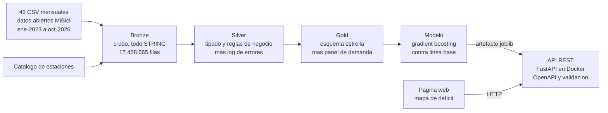
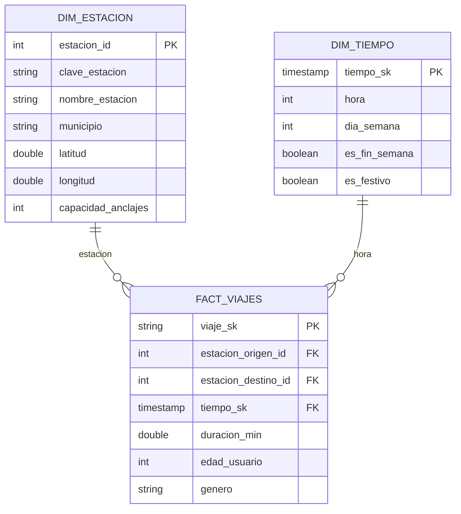

# MiBici · Predicción de demanda y rebalanceo de estaciones

Predice cuántas bicicletas van a salir y llegar a cada estación de MiBici en una hora dada, y
cuántas habría que trasladar para que la estación no se quede sin servicio.

**Proyecto final** — Aprendizaje Automático para Grandes Volúmenes de Datos
Especialidad en Ciencia de Datos · Universidad Panamericana, campus Guadalajara
Profesor: Dr. Ramón Alejandro Briseño Martínez
Equipo: **César Roberto Murillo Figueroa** y **Andrés Muñoz Rubalcava**

### En vivo

| | |
|---|---|
| **Mapa de rebalanceo** | https://mibici-api-v8k6.onrender.com/app/ |
| **Documentación del API** (OpenAPI) | https://mibici-api-v8k6.onrender.com/docs |
| **Estado del servicio** | https://mibici-api-v8k6.onrender.com/salud |

> El servicio corre en el plan gratuito de Render, que lo duerme tras 15 minutos sin tráfico.
> La primera visita después de un rato tarda entre 30 y 60 segundos en responder; las siguientes
> son inmediatas.

---

## El problema

MiBici es el sistema de bicicleta pública del área metropolitana de Guadalajara: 470 estaciones,
unos 7,995 anclajes y cerca de 400 mil viajes al mes. Tiene un problema que cualquiera que lo use
ha sufrido: **hay estaciones que se vacían y estaciones que se saturan**, todos los días, a las
mismas horas.

Los datos lo dicen sin ambigüedad. La estación **GDL-127, Av. Vallarta / Av. de Los Arcos**, tiene
19 anclajes. Un viernes a las 6 de la tarde salen de ahí 35.6 bicicletas y llegan 3.2:

```
salidas 35.6  −  llegadas 3.2  =  déficit de 32.4 bicicletas
32.4 bicicletas ÷ 19 anclajes  =  la estación se vacía 1.7 veces en una hora
```

Hoy el operador mueve bicicletas en camioneta por intuición y por reportes de usuarios, es decir,
reaccionando cuando el problema ya ocurrió. Este proyecto responde la pregunta un paso antes:
**¿cuántas bicicletas va a necesitar cada estación, mañana, a cada hora?**

---

## Qué se construyó



| Capa | Qué hace | Dónde está |
|---|---|---|
| **Bronze** | Ingesta cruda. Nada se castea, nada se limpia, nada se descarta | [`Notebooks/01_bronze_ingesta.py`](Notebooks/01_bronze_ingesta.py) |
| **Silver** | Tipado, fechas ISO, 9 validaciones, log de errores | [`Notebooks/02_silver_limpieza.py`](Notebooks/02_silver_limpieza.py) |
| **Gold** | Esquema estrella y panel de entrenamiento | [`Notebooks/03_gold_estrella.py`](Notebooks/03_gold_estrella.py) |
| **Modelo** | Entrenamiento, evaluación y exportación | [`Notebooks/04_modelo_demanda.py`](Notebooks/04_modelo_demanda.py) |
| **API** | Expone el modelo como servicio consultable | [`api/`](api/) |
| **Web** | Consume el API y pinta el mapa | [`web/index.html`](web/index.html) |

---

## Los datos

**Fuente:** [datos abiertos de MiBici](https://www.mibici.net/es/datos-abiertos/), publicados por el
Instituto de Movilidad y Transporte de Jalisco. Un CSV por mes más el catálogo de estaciones.

| | |
|---|---|
| Periodo | enero 2023 – octubre 2026 (46 meses) |
| Viajes | **17,468,665** |
| Válidos tras las reglas | 16,751,269 (95.89 %) |
| Incidencias registradas | 722,915 |
| Estaciones | 475 (470 del catálogo + 5 sin ficha) |
| Tamaño crudo | 1.39 GB (302 MB comprimido) |

### Lo que el perfilado encontró antes de escribir una línea de pipeline

Los 46 archivos **no son homogéneos**, y eso es lo que justifica que exista una capa Silver:

| Variación | Detalle |
|---|---|
| Codificación | 27 archivos en `windows-1252`, 19 en `UTF-8 con BOM` |
| Comillas y saltos de línea | 43 entrecomillados con `LF`; 3 sin comillas y con `CRLF` |
| Formato de fecha | 43 archivos en `aaaa-mm-dd hh:mm:ss`; **3 en `dd/mm/aaaa h:mm`** |
| Encabezado | `Año_de_nacimiento` aparece con 3 secuencias de bytes distintas, 2 corruptas |
| Llave | **758 `viaje_id` se repiten** entre archivos: no sirve como llave |

Un hallazgo que simplificó la ingesta: se verificó byte por byte que **ninguna fila de datos
contiene caracteres fuera de ASCII**. La `ñ` vive solo en el encabezado, que se descarta al leer.
Por eso Spark puede leer los 46 archivos en una sola pasada como UTF-8, sin partir la ingesta en
dos grupos por codificación.

---

## Las reglas de negocio

Siguen el estilo del taller RUES visto en clase. La regla que manda sobre todas las demás:
**un registro inválido no se borra.** Se conserva con `registro_valido = false` y cada violación
se escribe en el log de errores con `columna`, `mensaje_error` y `valor`. Borrarlos haría
imposible auditar después por qué desapareció un viaje, o medir si una regla es demasiado
agresiva.

| Regla | Qué hace |
|---|---|
| RN-01 | Unifica el esquema entre las tres variantes de formato |
| RN-02 | Nombres en `snake_case` sin acentos |
| RN-03 | Fechas a ISO 8601 desde los dos formatos de origen |
| RN-04 | Variables derivadas: duración, edad, calendario |
| RN-05 | Llave única `viaje_sk = anio-mes-viaje_id` |
| RN-06 | Columnas de auditoría: archivo de origen y fecha de carga |
| RN-07 | Los inválidos se marcan y se registran, no se eliminan |

### Las nueve validaciones y lo que encontraron

| Columna | Incidencia | Registros | Por qué importa |
|---|---|---:|---|
| `duracion_min` | Duración menor a 60 s | 549,047 | Falso retiro: sacan la bici y la regresan de inmediato |
| `genero` | Nulo o fuera de `{M,F,O}` | 115,563 | El usuario no declaró género |
| `duracion_min` | Fin ≤ inicio | 44,800 | Viaje imposible; error de reloj en la estación |
| `anio_nacimiento` | Nulo | 11,005 | Dato faltante en el registro |
| `edad_usuario` | Fuera de [10, 100] | 2,456 | Hay años de nacimiento como `199` o `2023` |
| `duracion_min` | Mayor a 24 h | 44 | Bicicleta no devuelta, no un viaje |
| `inicio_viaje` / `fin_viaje` | No parseable | 0 | Las dos variantes de formato quedaron cubiertas |
| `origen_id` / `destino_id` | Estación nula | 0 | Sin estación no hay join con la dimensión |

**Cómo se evita que la bandera y el log se contradigan:** las dos salen del mismo arreglo.
`registro_valido` es `size(incidencias) == 0` y el log es el `explode` de ese mismo arreglo.

### Las cinco estaciones fantasma

Cinco identificadores aparecen en los viajes pero no en el catálogo vigente de octubre 2026.
Las 240 y 310 se dieron de baja; las 124, 405 y 407 son altas que el catálogo aún no publica.
Entre las cinco tocan **14,047 viajes**. Se agregan a `dim_estacion` como *unknown members* en
lugar de descartar esos viajes, para que **ningún hecho quede huérfano de dimensión**.

---

## El esquema estrella



`FACT_VIAJES` apunta dos veces a `DIM_ESTACION`, por el origen y por el destino del viaje.

Más una tabla agregada, `gold_agg_demanda_estacion_hora`, que es la que entrena el modelo: una
fila por estación y hora de servicio, con salidas, llegadas, déficit y variables de rezago.

**La decisión de diseño que hay que defender ahí:** el panel incluye los ceros, porque un modelo
que solo ve horas con viajes sobreestima la demanda en todas partes. Pero no se densifica a lo
bruto: la red creció de 300 a 470 estaciones entre 2023 y 2026, y una estación inaugurada en 2026
no tuvo "cero demanda" en 2023 — simplemente no existía. Cada estación se densifica **solo dentro
de su propia vida útil**.

---

## El modelo

**Tarea: regresión.** Dos modelos, uno para salidas y otro para llegadas, porque el déficit es la
diferencia entre ambos y una estación puede tener mucho movimiento y estar en equilibrio.

**Métrica: RMSE, en bicicletas.** Se eligió sobre R² porque está en la unidad de la decisión —un
RMSE de 2.4 significa "se equivoca por unas 2.4 bicicletas", que se puede comparar contra la
capacidad de la estación y contra el costo de mandar un camión— y porque castiga más los errores
grandes, que aquí es lo correcto: fallar por 20 bicis en hora pico deja gente a pie, fallar por 1
en una estación tranquila no le importa a nadie. Se reporta **MAE** junto a él como control.

**Contra qué se compara: el promedio histórico** de esa estación, ese día de la semana y esa hora.
Es lo que cualquiera haría sin modelo. Un gradient boosting que no le gane no justifica su
existencia, y medirlo es parte del trabajo.

**Partición temporal, no aleatoria.** Se entrena con datos hasta el 31 de agosto de 2026 y se
evalúa con septiembre y octubre. Una partición aleatoria dejaría filtrarse el lunes siguiente al
entrenamiento y daría una métrica inflada que no se sostiene en producción.

### Por qué scikit-learn y no Spark MLlib

Spark hace el trabajo de volumen: convierte 17.4 millones de viajes en un panel agregado. Ese
panel ya cabe en memoria, y el entrenamiento corre con `HistGradientBoostingRegressor`.

La razón es de despliegue. Un modelo de MLlib solo se carga desde Spark, así que servirlo
obligaría a meter una JVM y Spark completo dentro del contenedor del API. El artefacto de
scikit-learn pesa unos megabytes y arranca en milisegundos, que es lo que un servicio HTTP
necesita. **Spark para los datos, scikit-learn para el modelo que se sirve.**

### El desajuste de features que hubo que resolver

El modelo usa variables de rezago —el promedio de las últimas 4 semanas para esa estación, día y
hora—. Al predecir un viernes futuro, ese promedio no existe todavía.

La tentación era usar el promedio histórico de 12 meses que el API ya tenía, pero habría sido un
error silencioso: el modelo se entrenó con una media de 4 observaciones (ruidosa) y recibiría una
de 52 (suave). Misma columna, otro significado. **El artefacto carga su propia tabla de rezagos**,
calculada sobre las últimas 4 semanas, con la misma ventana y la misma semántica del
entrenamiento.

---

## El API

Expone el modelo como servicio consultable. FastAPI genera el esquema **OpenAPI** y la
**validación de entradas** a partir de los modelos Pydantic, sin escribirlos a mano.

Documentación interactiva en `/docs`, esquema crudo en `/openapi.json`.

| Método | Ruta | Para qué |
|---|---|---|
| `GET` | `/salud` | Estado del servicio y qué modelo tiene cargado |
| `GET` | `/modelo` | Tipo, versión, métrica y features del modelo activo |
| `GET` | `/estaciones` | Catálogo para el mapa |
| `GET` | `/estaciones/{id}` | Ficha de una estación |
| `POST` | `/predecir` | Predicción para una estación y una hora |
| `POST` | `/predecir/lote` | Hasta 500 estaciones en una llamada (~10 ms para las 470) |

```jsonc
// POST /predecir
{ "estacion_id": 194, "fecha_hora": "2026-11-20T18:00:00" }

// respuesta
{
  "clave_estacion": "GDL-127",
  "nombre": "Av. Vallarta / Av. de Los Arcos",
  "salidas_estimadas": 35.558,
  "llegadas_estimadas": 3.192,
  "balance_estimado": -32.366,
  "deficit_bicis": 32.366,     // bicis que hay que llevar
  "capacidad_anclajes": 19,
  "saturacion": 1.703,          // se vacía 1.7 veces en esa hora
  "modelo_tipo": "hist_gradient_boosting",
  "modelo_version": "1.0.0"
}
```

### Validación

Toda entrada inválida se rechaza **antes** de llegar al modelo, con `{"detalle": "...", "codigo": "..."}`.

| Caso | HTTP | `codigo` |
|---|---|---|
| `estacion_id` fuera de `[1, 99999]` | 422 | `ENTRADA_INVALIDA` |
| `fecha_hora` no es ISO 8601 o está fuera de 2014–2030 | 422 | `ENTRADA_INVALIDA` |
| Lote vacío, con repetidos o de más de 500 | 422 | `ENTRADA_INVALIDA` |
| La estación no está en el catálogo | 404 | `NO_ENCONTRADO` |
| El servicio aún no arranca | 503 | `NO_DISPONIBLE` |

### Degradación explícita

Si el artefacto del modelo no está presente, el API **no falla ni miente**: responde con la línea
base histórica y lo declara en `/salud` (`estado: "degradado"`, `modelo_cargado: false`). La
página web lee ese campo y avisa al usuario que está viendo promedios, no predicciones.

---

## La página web

Un mapa de las 470 estaciones, coloreado por el déficit previsto a la hora que elijas, con la
lista de las 15 que más bicicletas necesitan.

**Consume el endpoint publicado por HTTP.** No carga el modelo ni la tabla de predicciones en el
navegador: una sola llamada a `/predecir/lote` alimenta el mapa completo.

Lo que maneja:

- **Timeout propio de 10 segundos** con `AbortController`.
- **Distingue los modos de falla:** error de petición (404/422) se le explica al usuario; error de
  servicio (5xx), timeout y caída de red ofrecen reintentar.
- **No asume la forma de la respuesta:** valida que venga la lista de predicciones y tolera
  `null` en latitud, longitud, capacidad y saturación.
- **Consulta `/salud` al cargar** y avisa si está viendo la línea base.

### Sobre los colores del mapa

Las teselas de OpenStreetMap siempre son claras, así que la superficie del gráfico es clara
aunque la página esté en modo oscuro. Los marcadores usan una rampa secuencial de un solo tono
anclada a esa superficie, con cortes absolutos en bicicletas (no cuantiles), para que el color
signifique lo mismo al cambiar de hora. Las estaciones sin déficit se dibujan chicas y
translúcidas: son contexto, no hallazgo. El rojo se reserva para las que se vacían por completo
y **siempre va acompañado de la etiqueta `SE VACÍA`**, nunca solo como color.

---

## Cómo correrlo

### El API y la página

```bash
cd api
pip install -r requirements.txt
uvicorn app.main:app --reload
```

- Mapa: http://localhost:8000/app/
- Documentación del API: http://localhost:8000/docs

Las pruebas del servicio corren sin levantar servidor:

```bash
cd api
python pruebas_api.py
```

Cubren las tres cosas que importan del endpoint: que prediga, que valide las entradas y que
cada error salga con su código correcto.

### Con Docker

```bash
docker build -t mibici-api -f api/Dockerfile .
docker run -p 8000:8000 mibici-api
```

### En Render

El repositorio trae [`render.yaml`](render.yaml), así que el despliegue es declarativo: en Render se
elige **New → Blueprint**, se conecta este repositorio y la plataforma construye el `Dockerfile`,
publica el servicio y lo vuelve a desplegar en cada push a `main`. No hace falta Docker en la
máquina local.

### Los notebooks

Se importan a Databricks (**Workspace → Import → File**) y se corren en orden. Antes del 01 hay
que subir los archivos de `Upload_Databricks/bronze/` a un Volume de Unity Catalog.

Cada notebook **se reconcilia solo**: compara sus resultados contra las cifras del perfilado y
truena si no cuadran al registro. Si el 02 termina, los 17,468,665 viajes se transformaron sin
perder ni duplicar uno.

---

## Estructura del repositorio

```
├── Notebooks/
│   ├── 01_bronze_ingesta.py       Ingesta cruda a Delta
│   ├── 02_silver_limpieza.py      Reglas de negocio y log de errores
│   ├── 03_gold_estrella.py        Esquema estrella y panel de demanda
│   └── 04_modelo_demanda.py       Entrenamiento, evaluación y exportación
├── api/
│   ├── app/
│   │   ├── main.py                Endpoints
│   │   ├── schemas.py             Contratos Pydantic → OpenAPI
│   │   ├── predictor.py           Baseline y modelo entrenado
│   │   └── catalogo.py            Catálogo de estaciones en memoria
│   ├── datos/                     Tabla baseline y artefacto del modelo
│   ├── pruebas_api.py             Pruebas del servicio
│   ├── Dockerfile
│   └── requirements.txt
├── web/
│   └── index.html                 Mapa de déficit
├── docs/
│   └── contrato_api.md            Contrato del servicio
├── render.yaml                    Despliegue del contenedor en Render
└── README.md
```

---

## Decisiones que vale la pena cuestionar

Las dejamos escritas porque son las que cambiarían el resultado:

1. **El umbral de 60 segundos** para considerar un viaje un falso retiro descarta 549,047
   registros, el 3.1 % del total. Es el criterio más agresivo del pipeline. Un umbral de 30 s
   dejaría pasar la mitad.
2. **El horario de servicio 5:00–23:00** en el panel de entrenamiento excluye las horas de
   madrugada. Entre las 2 y las 4 am hay menos de 30 viajes en toda la red y en todo el periodo,
   así que incluirlas solo agregaría ceros que el modelo aprende de memoria.
3. **Los rezagos de 4 semanas** suponen que la semana entrante se parece a las cuatro anteriores.
   Eso se rompe en vacaciones, en días de lluvia fuerte y cuando abre una estación nueva.
4. **El modelo no conoce el clima**, y en Guadalajara la temporada de lluvias mueve la demanda.
   Es la primera variable que valdría la pena agregar.

---

## Fuentes

- [Datos abiertos de MiBici](https://www.mibici.net/es/datos-abiertos/) — Instituto de Movilidad
  y Transporte del Estado de Jalisco. Viajes mensuales y nomenclatura de estaciones.
